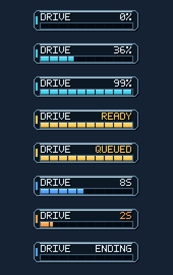

# Visible interface polish

## Drive HUD

The previous rounded card and system-font treatment was visually separate from
the game. The new renderer uses an angular, beveled plate, an authored 5x7 pixel
alphabet, integer scaling and a segmented gauge. Its default panel is 212x46
pixels instead of 224x58, reducing the covered area by about one quarter.

Charge, READY, QUEUED, active time and ENDING remain explicit. Active time of
three seconds or less adds a steady amber cue without flashing. Text and its
shadow are rendered by the same portable code used for the production image;
preview labels no longer depend on Windows font rendering.

This is an offscreen renderer preview, not captured gameplay. Native HP-area
placement, visual integration with enemies/effects and Windows presentation
still require a real game capture.

## Practice menu

Combat controls provides four short on-demand pages; the persistent option
description retains the core button guide. Encounter status reports preparation,
the active preset/target count and reset/retry state. Recovery produces one
notice after a failed encounter successfully resumes, without per-wave spam.

Control notices are short, single-line ASCII messages, matching the upstream
[0.1.5 scripting contract](https://github.com/Yokimitsuro/khdays-port/blob/v0.1.5/docs/SCRIPTING.md).

## Launcher

The old fixed client size could put controls below a laptop's work area at high
display scaling. Shared layout calculations now prioritize actions and status,
use a compact header on short displays, and reflow on resize/DPI changes.
Status text can be scrolled and copied. Keyboard default actions and idle focus
are explicit. Portable tests cover layout bounds; actual Windows interaction,
font rendering and monitor transitions remain to be validated.
